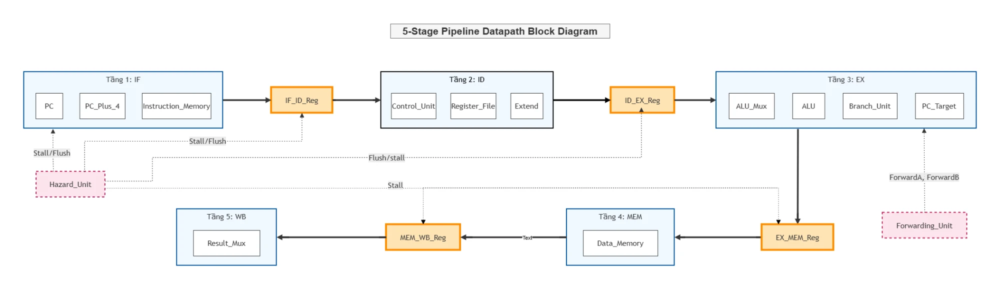

# Sơ đồ khối datapath lõi RISC-V 5 tầng

> Người giữ: Phát (P-07). Cập nhật: 25/10/2026. RTL: `rtl/core/`, ghép tầng ở `rtl/top/RISCV_Core.v`.

## Khối trong sơ đồ và module RTL tương ứng

| Tầng | Khối trong sơ đồ | Module RTL | Ghi chú |
| --- | --- | --- | --- |
| IF | PC, PC_Plus_4, Instruction_Memory | `IF_Stage` (`PC`, `PC_Plus_4`) | Instruction_Memory nằm ngoài lõi, nối qua `instr_addr` / `instr_rdata` (Boot ROM trong `SoC_Top`) |
| IF/ID | IF_ID_Reg | `IF_ID_Reg` | Giữ khi stall, chèn NOP khi flush |
| ID | Control_Unit, Register_File, Extend | `ID_Stage` (`Control_Unit` = `Main_Decoder` + `ALU_decoder`, `Register_File`, `Extend`) | Register_File ghi ở WB, có bypass ghi-đọc cùng chu kỳ |
| ID/EX | ID_EX_Reg | `ID_EX_Reg` | Flush thành bubble khi rẽ nhánh hoặc load-use |
| EX | ALU_Mux, ALU, Branch_Unit, PC_Target | `EX_Stage` (`ALU_Mux`, `ALU`, `Branch_Unit`, `PC_Target`) | Quyết định rẽ nhánh ở EX (`PCSrc_EX`) |
| EX/MEM | EX_MEM_Reg | `EX_MEM_Reg` | Mang thêm `funct3` cho load/store byte/half |
| MEM | Data_Memory | `MEM_Stage` | Data_Memory nằm ngoài lõi, nối qua `data_addr` / `data_wdata` / `data_wstrb` / `data_rdata` (bus AXI4-Lite trong `SoC_Top`). `MEM_Stage` lặp byte/half khi store và mở rộng dấu khi load |
| MEM/WB | MEM_WB_Reg | `MEM_WB_Reg` | |
| WB | Result_Mux | `WB_Stage` (`Result_Mux`) | Chọn ALU / dữ liệu load / PC+4 / PCTarget |
| — | Hazard_Unit | `Hazard_Detection` | Phát hiện load-use |
| — | Forwarding_Unit | `Forwarding_Unit` | ForwardA / ForwardB cho EX, ưu tiên MEM hơn WB |

## Tín hiệu điều khiển pipeline (theo `RISCV_Core.v`)

| Tín hiệu | Nguồn | Tác dụng |
| --- | --- | --- |
| `LoadUseStall` | `Hazard_Detection` (load ở EX, lệnh ở ID đọc đúng thanh ghi đó) | Giữ PC và IF/ID, chèn bubble vào ID/EX |
| `PCSrc_EX` | `Branch_Unit` (nhánh lấy, JAL, JALR) | PC nhảy tới `PCTarget_EX`, flush IF/ID và ID/EX |
| `bus_stall` | Bên ngoài lõi (`SoC_Top`: `(data_we \| data_re) & ~resp_valid`) | Đóng băng toàn pipeline: PC, IF/ID, ID/EX, EX/MEM, MEM/WB |
| `ForwardA`, `ForwardB` | `Forwarding_Unit` | Chọn toán hạng EX từ thanh ghi, MEM (`ForwardResult_MEM`) hoặc WB (`Result_WB`) |

## Điểm sơ đồ khác RTL (đề xuất khi vẽ lại)

Sơ đồ đúng ở mức khối. Các điểm sau đơn giản hóa so với RTL, nên sửa ở bản vẽ cho báo cáo cuối (Tuần 14–16):

1. **Nguồn stall/flush:** sơ đồ cho Hazard_Unit điều khiển tất cả thanh ghi pipeline. Trong RTL, `Hazard_Detection` chỉ tạo `LoadUseStall`. Flush khi rẽ nhánh đến từ `Branch_Unit` (`PCSrc_EX`), còn đóng băng EX/MEM và MEM/WB đến từ `bus_stall` bên ngoài lõi.
2. **Thiếu đường hồi tiếp:** EX → IF (`PCTarget_EX`, `PCSrc_EX`), WB → Register_File (`Result_WB`, `Rd_WB`, `RegWrite_WB`), và dữ liệu forward từ EX/MEM, MEM/WB về EX.
3. **Bộ nhớ:** Instruction_Memory và Data_Memory vẽ trong tầng IF và MEM. Trong RTL hai khối này nằm ngoài lõi (Boot ROM và bus AXI4-Lite của `SoC_Top`), nên vẽ ở mép tầng, nối qua cổng của lõi.
4. **Nhãn sót:** mũi tên MEM → MEM_WB_Reg còn chữ "Text".
5. **Đầu vào của Hazard_Unit và Forwarding_Unit** (`MemRead_EX`, `Rd_EX`, `Rs1/Rs2`, `Rd_MEM`, `Rd_WB`, `RegWrite_*`) chưa vẽ.
